# Orderly 🧹


Orderly is a command-line tool written in Rust for automating the organization of files on your macOS system. Inspired by Hazel, Orderly allows users to define rules and actions to keep their files neat and tidy 🧹

## Features

- Rule-based file organization driven by a single YAML file
- Per-folder pipelines with ordered rules (first match wins per file)
- Built-in actions: `move`, `copy`, `delete` (to Trash), `sort_by_date`
- Built-in conditions: `always`, `name`, `extension`, `name_contains`, `is_duplicate`, `older_than`
- Content-hash duplicate detection (blake3, size-bucketed — zero cost unless a rule opts in)
- `--dry-run` preview + terminal table report (works for `--run` and `--watch`)
- File-system watching via `notify`

## Installation

Ensure you have Rust installed, then:

```bash
cargo install --path .
```

Or build directly from the repo:

```bash
cargo build --release
./target/release/orderly --help
```

## Usage

Orderly is driven by a single YAML config at `rules/example.yaml`. The CLI exposes four flags that can be combined:

| Flag                | Purpose                                                                 |
| ------------------- | ----------------------------------------------------------------------- |
| `-i`, `--init`      | Write a starter `rules/example.yaml` into the current directory.        |
| `-r`, `--run`       | Apply the rules once, then exit.                                        |
| `-w`, `--watch`     | Apply rules once, then keep running and re-apply on file-system events. |
| `-d`, `--dry-run`   | Preview only: print the report, change nothing on disk.                 |

Typical workflows:

```bash
orderly --init                # seed rules/example.yaml
orderly --run --dry-run       # preview what would happen
orderly --run                 # actually organize files
orderly --watch               # keep organizing as files arrive
orderly --watch --dry-run     # watch + preview, no filesystem changes
```

Every run prints a terminal table summarizing what happened (or, in dry-run mode, what *would* happen):

```
┌──────────┬───────────────────────┬───────────────┬──────────────────────────────┬──────────────┬──────────────┬─────────────────────────┬──────────┐
│ When     │ Folder                │ File          │ Rule                         │ Condition    │ Action       │ Destination             │ Status   │
├──────────┼───────────────────────┼───────────────┼──────────────────────────────┼──────────────┼──────────────┼─────────────────────────┼──────────┤
│ 16:07:03 │ ~/Desktop             │ notes.txt     │ Sweep Desktop into Downloads │ always       │ move         │ ~/Downloads             │ EXECUTED │
│ 16:07:03 │ ~/Downloads           │ dup_b.txt     │ Trash duplicates             │ is_duplicate │ delete       │ <trash>                 │ EXECUTED │
│ 16:07:03 │ ~/Downloads           │ song.mp3      │ Music to ~/Music             │ extension    │ move         │ ~/Music                 │ EXECUTED │
│ 16:07:04 │ ~/Movies/CleanShot    │ old_clip.mp4  │ Trash captures older than 30d│ older_than   │ delete       │ <trash>                 │ EXECUTED │
└──────────┴───────────────────────┴───────────────┴──────────────────────────────┴──────────────┴──────────────┴─────────────────────────┴──────────┘
Summary: 0 planned, 4 executed, 0 skipped, 0 errored (4 total)
```

In dry-run the `Status` column shows `PLANNED` and no `fs::rename`, `fs::copy`, or `trash::delete` is called.

## Configuration

Orderly reads `rules/example.yaml`. A rule file has three top-level keys:

```yaml
name: Orderly Sandbox Rules
description: Rules for organizing files in the sandbox environment
folders:
  - path: /absolute/path/to/folder
    match_type: all
    rules:
      - name: Human-readable rule name
        conditions:
          - condition_type: extension
            value: mp3,flac,wav
        actions:
          - action_type: move
            path: /absolute/path/to/destination
```

### Supported conditions

| `condition_type` | `value`                                | Matches when…                                                            |
| ---------------- | -------------------------------------- | ------------------------------------------------------------------------ |
| `always`         | `""`                                   | The entry is a file.                                                     |
| `name`           | `exact-name.ext`                       | The file name is exactly equal (case-sensitive).                         |
| `name_contains`  | `substring`                            | The full path contains `substring` (case-sensitive).                     |
| `extension`      | `mp3,flac,wav,...`                     | The extension is in the comma-separated list.                            |
| `is_duplicate`   | `""`                                   | The file is a content-hash duplicate of an older sibling in the folder.  |
| `older_than`     | `30d`, `14d`, `2w`, `6h`, `45m`, `30s` | The file's mtime is at least that old. Units: `s`, `m`, `h`, `d`, `w`.   |

`is_duplicate` uses a two-phase check: files are first bucketed by size, and only size-collision buckets are hashed with blake3. For each content hash, the file with the oldest mtime is kept as canonical — everything newer evaluates `true`. Folders whose rules don't mention `is_duplicate` pay zero hashing cost.

### Supported actions

| `action_type`   | Required fields         | Behavior                                                               |
| --------------- | ----------------------- | ---------------------------------------------------------------------- |
| `move`          | `path`                  | Rename-or-copy-and-delete the file into `path`. Creates dirs as needed.|
| `copy`          | `path`                  | Copy the file into `path`.                                             |
| `delete`        | —                       | Move to the OS Trash via the [`trash`](https://crates.io/crates/trash) crate. |
| `sort_by_date`  | `path`, `pattern`       | Move into `path/<chrono-formatted-mtime>/<filename>`. The pattern can include multiple path segments, e.g. `"%Y/%m - %b"` (year/month folders) or `"%Y/invoices"` → `.../2025/invoices/file.pdf`. |

`match_type: all` is the only currently honored value — it exists so future versions can introduce `any`/`all_of`/`any_of` without breaking files.

## Example Rule Strategy

The bundled `rules/example.yaml` models a pipeline, not a flat list. Files flow through stages, each stage with a clear responsibility:

```mermaid
flowchart TD
  Desktop["~/Desktop (inbox)"]
  Downloads["~/Downloads (fan-out hub)"]

  subgraph Dedup["dedup + trash installers first"]
    direction TB
    DupDL["is_duplicate → trash"]
    Inst["extension: installers → trash"]
    Arc["extension: archives → ~/Downloads/Archives"]
  end

  subgraph Media["media fan-out"]
    direction TB
    Music["extension: music → ~/Music"]
    Movies["extension: video → ~/Movies"]
    Pictures["extension: images → ~/Pictures"]
  end

  subgraph Docs["document fan-out"]
    direction TB
    Inbox["extension: inbox_all → ~/Documents/Inbox"]
    Code["extension: code → ~/Developer/Inbox"]
  end

  subgraph DocsPost["~/Documents/Inbox post-processing"]
    direction TB
    DocDup["is_duplicate → trash"]
    Keys["name_contains → Finance/Legal/HR/Personal (sort_by_date)"]
    Cold["older_than 730d → _Archive/YYYY/cold-inbox"]
    Ebook["extension: ebooks → Ebooks/YYYY/MM - Mmm"]
    Design["extension: design → Design/YYYY/MM - Mmm"]
    ThreeD["extension: 3d → 3D/YYYY/MM - Mmm"]
    Work["extension: office → Work/YYYY/MM - Mmm"]
    Gen["extension: plain docs → General/YYYY/MM - Mmm"]
  end

  subgraph PicturesPost["~/Pictures post-processing"]
    direction TB
    PDup["is_duplicate → trash"]
    Shots["name_contains: screenshot → Pictures/Screenshots"]
    Wallp["name_contains: wallpaper/unsplash/pexels → Pictures/Wallpapers"]
    CSPic["name_contains: CleanShot → Pictures/CleanShot"]
    PSort["extension: images → Pictures/Photos/%Y/MM - Mmm (sort_by_date)"]
  end

  subgraph MoviesPost["~/Movies post-processing"]
    direction TB
    MDup["is_duplicate → trash"]
    CSMov["name_contains: CleanShot → Movies/CleanShot"]
    WAMov["name_contains: WhatsApp or -WA0 → Movies/WhatsApp"]
    MSort["extension: video → Movies/Library/%Y/MM - Mmm (sort_by_date)"]
  end

  subgraph Stale["age-based cleanup"]
    direction TB
    StaleCS["Movies/CleanShot: older_than 30d → trash"]
    StaleWA["Movies/WhatsApp: older_than 14d → trash"]
  end

  Desktop -->|always: move| Downloads
  Downloads --> Dedup
  Dedup --> Media
  Dedup --> Docs
  Docs --> DocsPost
  Media --> PicturesPost
  Media --> MoviesPost
  PicturesPost --> Stale
  MoviesPost --> Stale
```



### Why this shape?

1. **Single inbox → single fan-out hub.** `~/Desktop` is treated as an inbox and swept into `~/Downloads` with a catch-all `always` rule. That way the classification logic only has to live in one place.
2. **Dedup runs first, everywhere it matters.** In `~/Downloads`, `~/Pictures`, and `~/Movies` the very first rule is `is_duplicate → delete`. This guarantees duplicates never reach a "real" destination, where they would be harder to find and harder to dedup across siblings.
3. **Quarantine before classification.** Installer images (`.dmg`, `.iso`, `.pkg`, `.msi`, `.exe`) are trashed immediately; archives are parked in `~/Downloads/Archives` for manual triage. This keeps the fan-out step focused on *content*, not *wrappers*.
4. **Rules are ordered narrow-to-broad.** The engine processes rules top-to-bottom and marks a file "processed" on the first match. So a specific `name_contains: CleanShot` rule must sit above the broad `extension: images` / `extension: video` fallback, or the fallback would steal its files.
5. **Two-stage destinations: categorize, then subdivide.** Once images land in `~/Pictures`, a second pass sub-sorts them: named buckets (`Screenshots`, `Wallpapers`, `CleanShot`) first, then a `sort_by_date` fallback into `Photos/YYYY/MM - Mmm`. Same pattern for `~/Movies`: named buckets (`CleanShot`, `WhatsApp`) then a `Library/YYYY/MM - Mmm` fallback.
6. **Documents: one inbox, then function/year/retention.** Downloads sends all document-like types (plain, Office, ebooks, design, 3D) to `~/Documents/Inbox`. A dedicated folder block routes by filename keywords into `Documents/<Function>/YYYY/<retention>/` (via multi-segment `sort_by_date` patterns such as `"%Y/invoices"`), sends files older than two years to `Documents/_Archive/YYYY/cold-inbox`, then uses extension fallbacks into `Ebooks`, `Design`, `3D`, `Work`, and `General` with `YYYY/MM - Mmm` month folders. Important originals should be named `YYYY-MM-DD_description.ext` by hand; Orderly does not rename files yet.
7. **Age-based cleanup is a separate folder block.** `~/Movies/CleanShot` and `~/Movies/WhatsApp` each get their own folder block with an `older_than` rule. This keeps age thresholds adjustable per-bucket (30 days for screen recordings, 14 days for chat videos) without mixing age logic into the classification rules.
8. **Zero-cost features.** The blake3 duplicate scan only runs for folders whose rules actually use `is_duplicate`; `older_than` is a cheap `stat` call. You pay for what you use.

### Tuning the example

- Change the top-level `path:` entries to match your own username (the shipped config hardcodes `/Users/vitoralencar/...`).
- Create the document inbox once: `mkdir -p ~/Documents/Inbox` — Orderly only scans paths that exist; without this folder, the `Documents/Inbox` rules are skipped with a warning.
- Adjust `older_than` durations to taste (`s`/`m`/`h`/`d`/`w`; no `months`/`years` on purpose).
- Add more `name_contains` rules before the `sort_by_date` fallbacks to carve out new buckets without rewriting the classification stage.
- Comment out rules instead of deleting them while iterating — `--dry-run` makes it safe to experiment.

## Contributing

We welcome contributions to Orderly! To contribute, follow these steps:

1. Fork the repository
2. Create a new branch (`git checkout -b feature/your-feature`)
3. Commit your changes (`git commit -am 'Add some feature'`)
4. Push to the branch (`git push origin feature/your-feature`)
5. Create a new Pull Request

## Supported Operating Systems

Orderly is currently supported on macOS and Windows.

## License

This project is licensed under the MIT License. See the [LICENSE](LICENSE) file for details.

## Acknowledgements

Orderly is inspired by [Hazel](https://www.noodlesoft.com/), a similar tool for macOS.

## Cursor Project Rule

This repository includes a project-scoped Cursor rule at `.cursor/rules/karpathy-guidelines.mdc`.
It applies Karpathy-inspired coding guidelines for agent behavior in this workspace only.
Source: [forrestchang/andrej-karpathy-skills](https://github.com/forrestchang/andrej-karpathy-skills).
